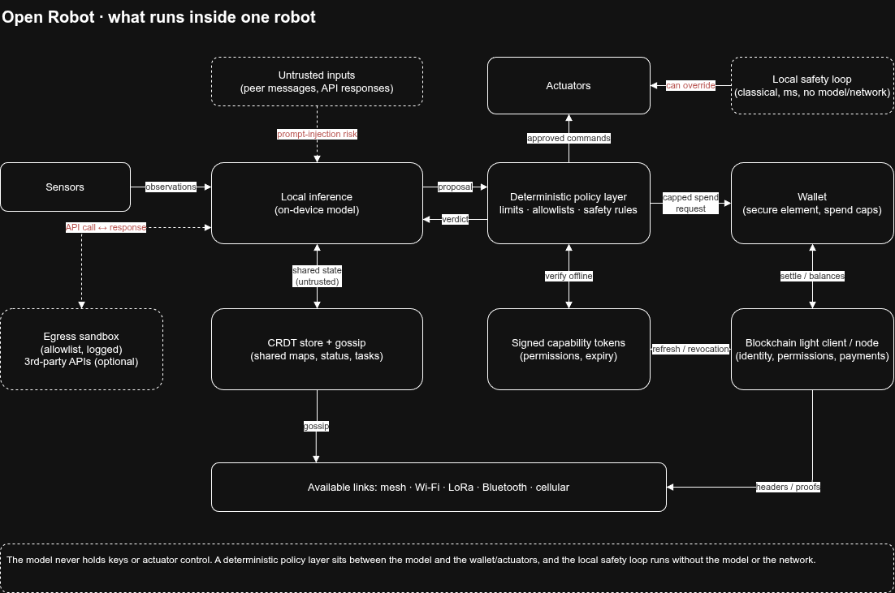

# Open robot

##### App Description (**Alpha**)

A robot runs its independent blockchain node
Permissions may be published and enforced via blockchain
Robots communicate with each other and synchronise via available links always in distributed not decentralised:

- **Peer-to-peer sync over whatever links exist.** This is the right model for robots, since connectivity comes and goes (mesh, Wi-Fi, LoRa, Bluetooth, cellular).
- **No single point of failure.** If a base station or cloud service dies, the fleet keeps working.
- **Local autonomy.** Each robot decides from the state it has, instead of waiting on a server.

CRDT or gossip layer for shared state?

A robot runs its independent wallets
A robot may or may not be able to call external 3rd parties API
A robot will run its fully independent super intelligence pear, local inference 

Still unsolved?
The physical world is the oracle. The network can’t verify a robot’s sensor claim. Mitigate with cross-validation between robots and secure hardware attestation.
Sybil and rogue robots. Signed identities, credentials, and reputation are needed so one bad robot can’t flood the fleet.
Accountability. Someone needs a revocation and emergency-stop path, even in a distributed design.