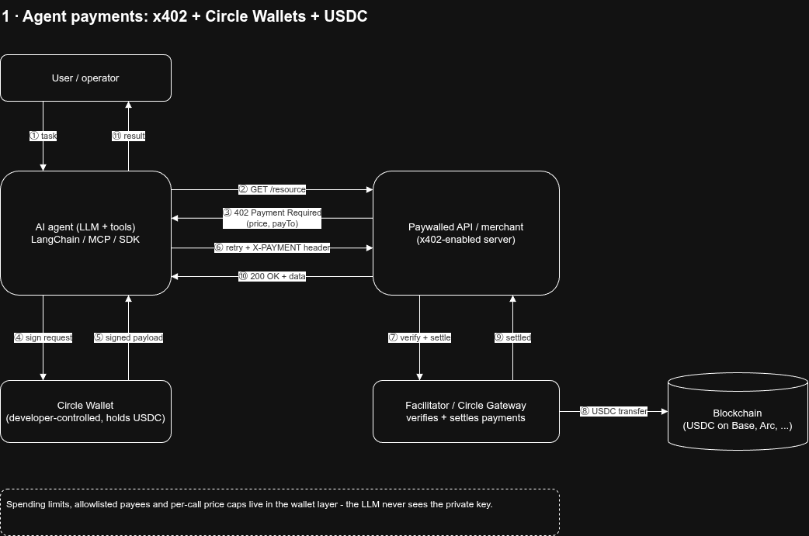
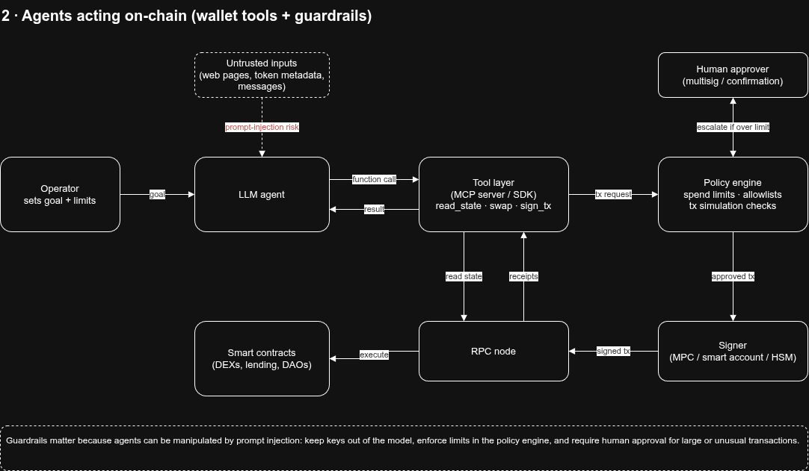
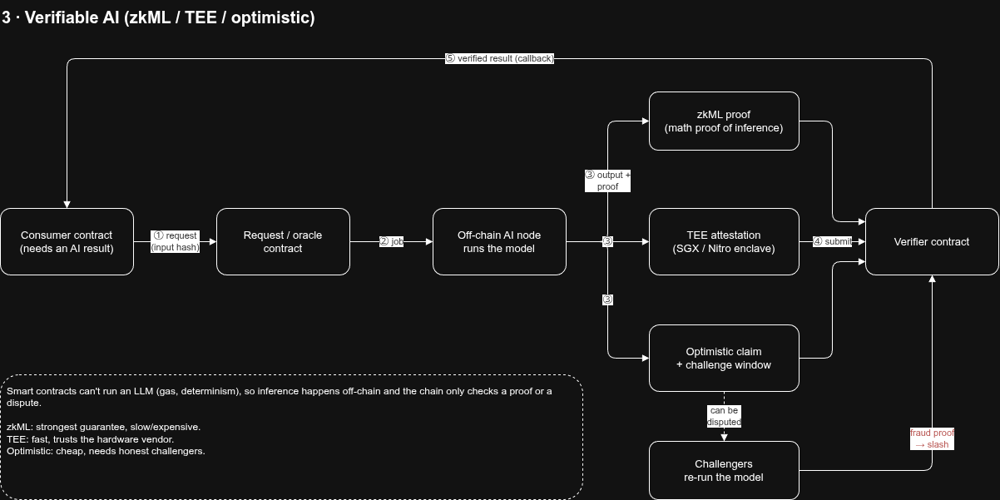
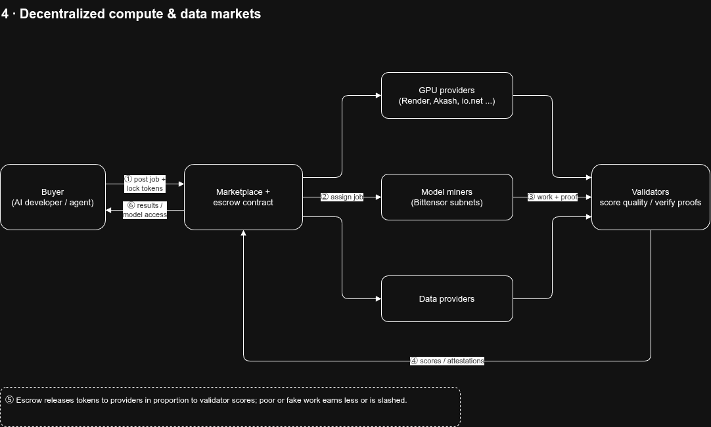
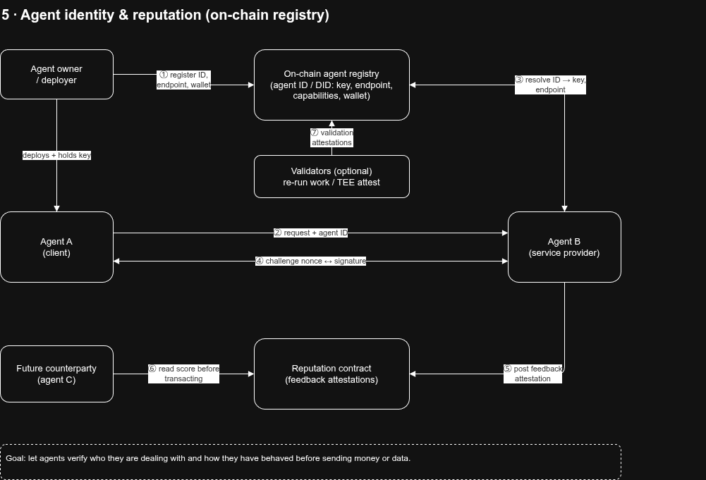

"AI integration with blockchain" covers a few different things. Circle's work for USDC falls into the first one, which is the most active area right now.

## 1. Agents paying for things (the Circle/USDC piece)

An AI agent can't open a bank account or hold a credit card, but it can control a crypto wallet. The pieces fit together like this:

- **A wallet for the agent.** In Circle's sample app, a LangChain-based AI agent acts on behalf of a user, using Circle's Developer-Controlled Wallets. The developer holds the keys and sets the rules, and the agent just calls an API to spend.
- **A payment protocol, x402.** Coinbase's x402 protocol revives HTTP 402 ("Payment Required") to enable onchain payments within standard web requests. The flow is simple: the agent requests an API, the server replies "402, pay X USDC," the agent signs a payment, retries, and gets the data. No signup, API key, or invoice is involved.
- **USDC as the settlement asset.** A stablecoin lets an agent pay a few cents per call without price volatility. Circle's reported figure is that USDC accounted for 99.3% of x402 payment volume in Q2 2026.
- **Cheaper micropayments.** On May 11, 2026, Circle announced its Agent Stack, which gives agents wallets, service discovery, and high-frequency USDC payments. Under its nanopayments design, agents fund a Gateway balance with USDC, authorize payments with signed messages, and avoid per-transaction gas fees.
- **Dedicated infrastructure.** Circle is also building Arc, an L1 chain aimed at financial markets and agent activity, with public mainnet scheduled for September 16, 2026. I haven't checked whether it has launched yet.
- **Industry standardization.** The x402 Foundation launched in July 2026 with 40 members, including Visa, Mastercard, Stripe, AWS, Cloudflare, Google, and Coinbase.

**Reality check:** adoption is still early. One tracker saw 8.7 million x402 transfers in a week, but only about $368K in total volume, around 4 cents each. A separate analysis noted that fewer than 1% of the SaaS and API services agents use accept USDC.

## 2. Other ways AI and blockchain connect

- **Agents acting on-chain.** LLM agents read contract state, execute swaps, manage DeFi positions, or run DAO operations through wallet tools (e.g., MCP servers or SDKs that wrap signing). Guardrails such as spending limits, allowlists, and multisig matter a lot here, since agents can be tricked by prompt injection.

  

- **Verifiable AI.** Blockchains can anchor proofs that a specific model produced a specific output (zkML, TEEs, or optimistic verification), which is useful when a smart contract needs to trust an AI result.

  

- **Decentralized compute and data markets.** Networks like Bittensor, Render, and Akash use tokens to pay for GPUs, training, and inference.

  

- **Agent identity and reputation.** Standards for registering agents onchain, so other agents or services can verify who they are and how they've behaved, are emerging.

  

## Typical architecture

1. The LLM decides it needs something (data, compute, a purchase).
2. A tool layer exposes "pay" or "send transaction" as a function.
3. A wallet service signs under policy limits.
4. The chain settles, and the merchant or API verifies and delivers.

If you're looking to build something, I can walk through a working agent that pays an x402 endpoint with USDC. Tell me your language and stack (Python/LangChain, TypeScript, etc.) and I'll write out the complete files.